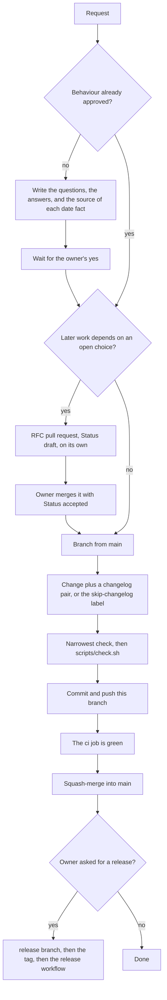

# AGENTS.md

## Project overview

Calendo answers holiday and working-day questions for AI agents. It is a Python package
(`src/calendo/`) with a core that computes every answer and adapters that expose it: an HTTP API
and an MCP server. The package is pre-alpha: `src/calendo/` currently exposes `__version__` only.
Product direction lives in `docs/product/`. Design decisions live in `rfcs/`.

The nearest `AGENTS.md` wins when two of them disagree. The root file is the flow. The nested
files are the rules for the directory they sit in. Long checklists (tests, what to run, a release,
prose) stay in `.agents/skills/calendo-dev/reference/`. `.claude` links to `.agents`.

## Setup commands

- Install: `uv sync` (uv 0.11.32 or later in the 0.11 line; it installs the Python in
  `.python-version`)
- Full local chain: `sh scripts/check.sh` (style, typecheck and test; CI also builds the package
  and, on a pull request, checks the changelog and RFC records)
- Format: `uv run ruff format .`
- Lint: `uv run ruff check --fix .`
- Typecheck: `uv run pyright`
- Test: `uv run pytest`, or one file: `uv run pytest tests/tooling/test_check_changelog.py`

## Repository layout

| Path | Holds |
| --- | --- |
| `src/calendo/` | The package |
| `tests/` | pytest suites; `tests/tooling/` tests the repository checks |
| `scripts/` | `check_changelog.py`, `check_rfcs.py`, `check_release.py`, `check.sh` |
| `changelog/` | One entry pair per change; `changelog/README.md` is the format |
| `rfcs/` | Design RFCs; `rfcs/README.md` is the process and the index |
| `docs/product/` | Product direction documents |
| `.github/` | CI and release workflows, issue forms, PR template, `CONTRIBUTING.md` |

Search inside the repository. When a path does not resolve, ask `git ls-files`.

| When you change | Read |
| --- | --- |
| `src/calendo/` | [`src/calendo/AGENTS.md`](src/calendo/AGENTS.md) |
| `tests/` | [`tests/AGENTS.md`](tests/AGENTS.md) |
| `changelog/` | [`changelog/AGENTS.md`](changelog/AGENTS.md) |
| `rfcs/` | [`rfcs/AGENTS.md`](rfcs/AGENTS.md) |
| `docs/` | [`docs/AGENTS.md`](docs/AGENTS.md) |
| `.github/` | [`.github/AGENTS.md`](.github/AGENTS.md) |

## Development flow

A product document or an issue can supply the wording of the proposal. Neither replaces the
owner's yes for behaviour the owner has not approved. When the owner's later words conflict with
a document, the owner's words win; say which line they override.

A merged RFC with `Status: draft` is still a draft. It does not change this flow and it does not
authorise the implementation. The implementation that depends on a decision is a later pull
request and cites the RFC by number.

Once `sh scripts/check.sh` passes, commit and push the current branch. Say what you ran and what
it printed, in the reply and in the pull request. A check you did not run did not pass. Never
push to `main`. A force push still needs the owner's yes.

Stop and ask the owner, instead of picking a side, when the library, a fixture and an expected
answer disagree, when the change would upgrade `holidays`, or when the scope moves. The same list
is under "Ask the owner first".

## Testing instructions

- How to write a test is in [`tests/AGENTS.md`](tests/AGENTS.md). What to run is in
  `.agents/skills/calendo-dev/reference/verification.md`.
- The jobs, the required `ci` check and the release order are in
  [`.github/AGENTS.md`](.github/AGENTS.md).
- The flow above is when `sh scripts/check.sh` runs. Report what you ran and what it printed.

## Code style

- Python 3.12 or later, pyright strict over `src/`, `scripts/` and `tests/`.
- ruff, line length 100. The rule set is in `pyproject.toml`.
- English for code, comments, error messages, test names, commits and pull requests. Chinese only
  in `*.zh.md` files and in data such as `zh_CN` holiday names.

## Changelog and RFCs

- Every change adds an entry pair to `changelog/unreleased/`: `YYYY-MM-DD-<slug>.md` and
  `YYYY-MM-DD-<slug>.zh.md`, in the same pull request. A change nobody reads or runs gets the
  `skip-changelog` label instead.
- A decision later work builds on goes into an RFC first, in its own pull request. Only the owner
  accepts an RFC.
- `scripts/check_changelog.py` and `scripts/check_rfcs.py` check both formats.

## Pull requests

- Branch from `main` as `feat/`, `fix/`, `data/`, `docs/` or `chore/<topic>`. One topic per pull
  request.
- Title the pull request as the squash commit: `feat(core): count working days across a range`.
- Fill in `.github/PULL_REQUEST_TEMPLATE.md`, including the verification output.
- Pull requests are squash-merged once `ci` is green. Never push to `main`.

## Ask the owner first

- Changing behaviour the owner has not approved, or changing scope.
- Accepting an RFC, cutting a release or pushing a tag.
- Upgrading `holidays` or deciding between conflicting date sources.
- Force-pushing, rewriting history, deleting a branch, changing repository settings or secrets.

## Security

- Report a vulnerability through the private advisory form linked in `.github/SECURITY.md`, not a
  public issue.
- Keep credentials, tokens and private data out of the diff, logs and screenshots.
